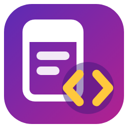
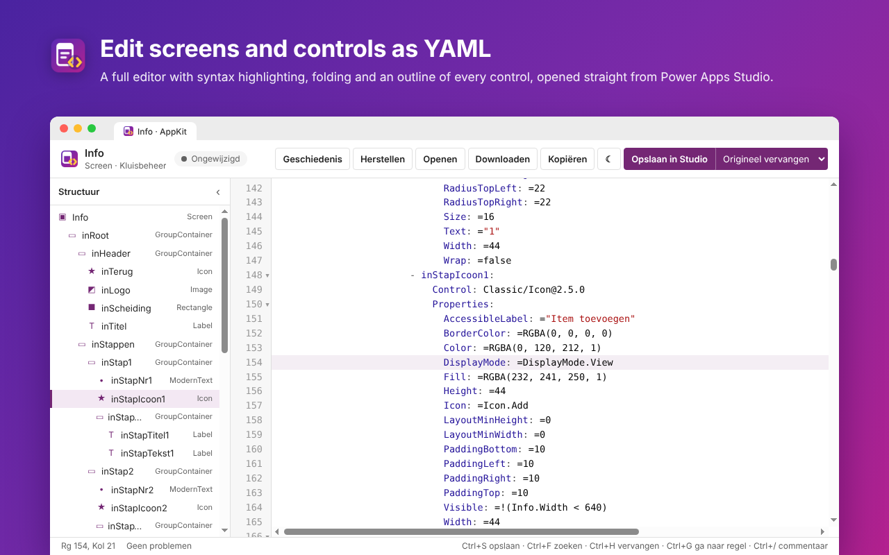
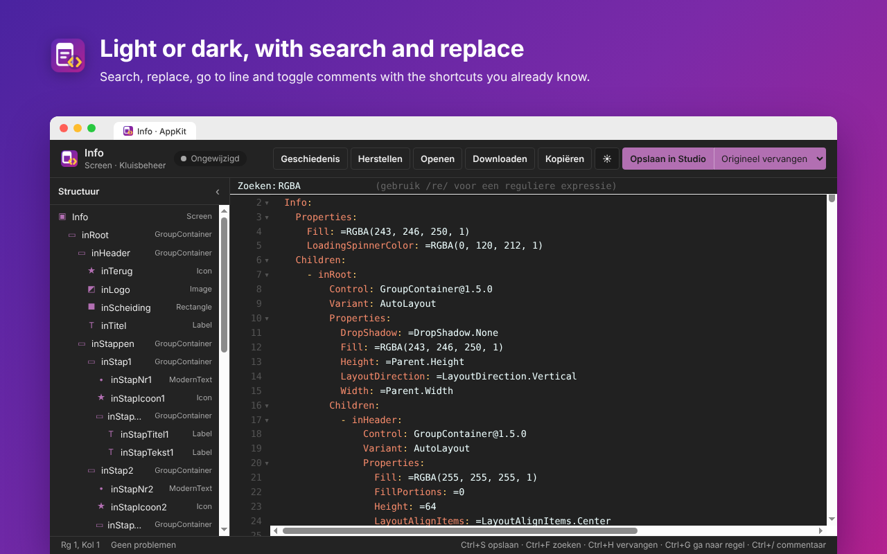

  

<h1 align="center">AppKit for Power Apps</h1>

  Edit the screens and controls of your Power Apps canvas apps as YAML from a single browser extension.

Power Apps Studio shows the code of a screen in **View code**, but that editor is read-only. AppKit opens the screen or control you selected in Studio in a full YAML editor. There you edit the code, see errors right away and put the result back in Studio with one click. The extension works in Microsoft Edge and Chrome.

The interface of the extension is in Dutch. Button names below are given in Dutch with the English meaning in brackets.

## Features

### YAML editor
Edit a full screen or a single control in an editor with syntax highlighting, line numbers and collapsible blocks. The outline panel lists every screen, container and control with its type. Click a name to jump to it. From the toolbar you can:

- **Opslaan in Studio** (Save to Studio): put the code back in Power Apps Studio, also with Ctrl+S.
- **Kopiëren** (Copy) and **Downloaden** (Download): copy the code to the clipboard or save it as a `.pa.yaml` file.
- **Openen** (Open): load a YAML file you saved earlier.
- **Herstellen** (Restore): go back to the code as it came from Studio.

### Checks while you type
The editor checks the code as you type. Errors in the YAML structure are marked in red. A property whose formula does not start with `=` and a name that is used more than once get a warning, because Studio rejects or renames them when pasting. Click the problem count at the bottom to jump to the first problem.

### Replace the original in Studio
When you save with **Origineel vervangen** (Replace original), AppKit deletes the original screen or control in Studio and pastes the new code in the same place. All names stay the same, so references in formulas keep working. If Studio rejects the new code, AppKit restores the original automatically. You can always undo the replacement in Studio with Ctrl+Z. Choose **Als nieuw toevoegen** (Add as new) to paste the code as an extra screen or control instead.

### Drafts and history
Changes are saved as a draft automatically. If you close the tab by accident, they are waiting for you the next time. Every version you save to Studio is added to the history, where you can restore any of the last 30 versions with one click.

### Light and dark, with the shortcuts you know
Switch between a light and a dark theme with one click. Search (Ctrl+F), replace (Ctrl+H), go to line (Ctrl+G), toggle comments (Ctrl+/), move lines (Alt+arrow) and duplicate lines (Shift+Alt+Down) work like in other code editors.

## Usage
1. Open a canvas app in [Power Apps](https://make.powerapps.com) in edit mode.
2. Select the screen or control you want to edit in the tree view.
3. Click **YAML bewerken** (Edit YAML) in the bottom right of Studio, press **Ctrl+Shift+Y**, or click the AppKit icon in your browser toolbar and choose **Selectie openen in editor** (Open selection in editor). The icon is only active on Power Apps pages.
4. The code opens in a new tab. Edit it and click **Opslaan in Studio** (Save to Studio).

If pasting automatically does not work, the code is on the clipboard and you can press **Ctrl+V** in the tree view yourself. Studio cannot delete the last screen of an app; in that case, add an empty screen temporarily. If replacing fails, click **Diagnose kopiëren** (Copy diagnostics) in the editor and add the text to an [issue](https://github.com/StanFV/AppKit/issues).

Don't need the **YAML bewerken** button in Studio? Hover over it and click the **×** to hide it. You can still open the editor with Ctrl+Shift+Y or the toolbar icon, and turn the button back on in the menu of the toolbar icon.

To use AppKit in an InPrivate window, turn on "Allow in InPrivate" on the details page of the extension in `edge://extensions`.

## Installation
AppKit is available in Microsoft Edge Add-ons store: https://microsoftedge.microsoft.com/addons/detail/appkit-for-power-apps/kjpegkinccbigjoalhjjegappajbjgmb. You can also install the extension like this:

1. Download or clone this repository.
2. Go to `edge://extensions` in Edge or `chrome://extensions` in Chrome.
3. Turn on developer mode.
4. Choose "Load unpacked" and select the `extension` folder.
5. Refresh any Power Apps tab that was already open.

## Privacy
AppKit has no servers of its own, makes no network requests and collects no data. The code of your app is only processed in your browser. Drafts and history are stored locally in the browser. Read the full [privacy policy](PRIVACY.md).

## Project structure

| Folder or file | Contents |
| --- | --- |
| `extension/` | The extension itself, ready to load or to zip for Edge Add-ons |
| `extension/src/background.js` | Recognises Power Apps pages and links editor tabs to Power Apps Studio |
| `extension/src/content/` | The button in Studio and reading, replacing and pasting YAML |
| `extension/editor/` | The editor with validation, outline and history |
| `extension/vendor/` | CodeMirror 5 and js-yaml, with their license files |
| `design/` | Icon source files (`icon.svg`, `icon-small.svg` for 16 and 32px) and large versions for the store |
| `design/store-screenshots/` | Screenshots for the store and this README |

## Credits
The editor uses [CodeMirror 5](https://codemirror.net/5/) and [js-yaml](https://github.com/nodeca/js-yaml), both under the MIT license.

AppKit is not affiliated with or endorsed by Microsoft. Power Apps is a trademark of the Microsoft group of companies.
