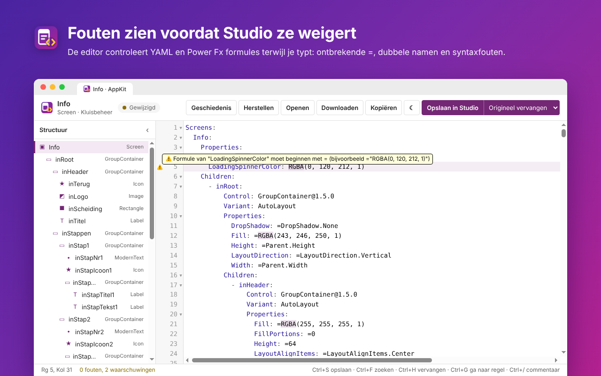
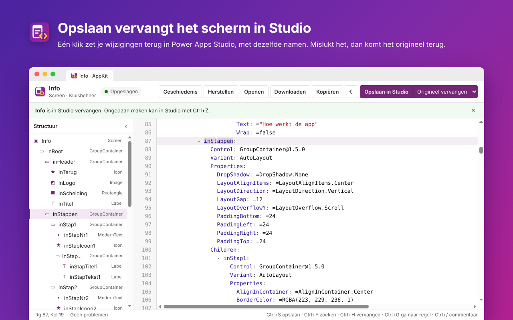
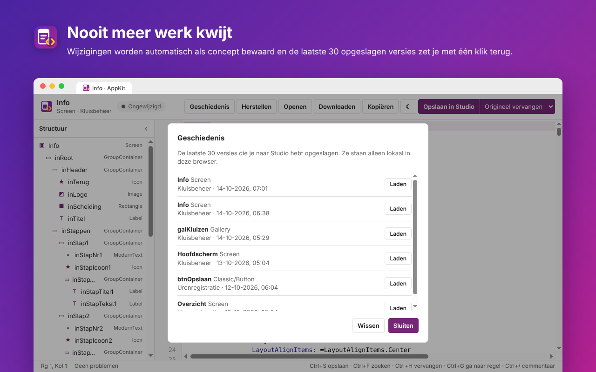
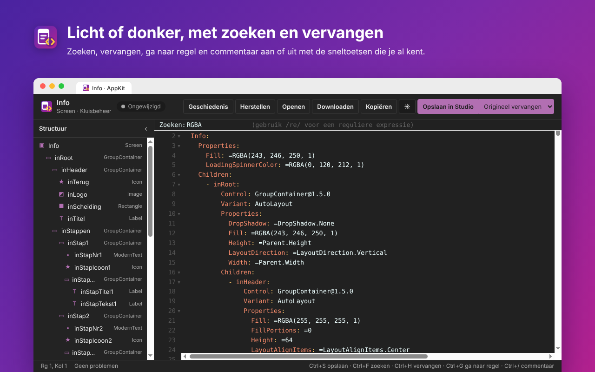

<p align="center">
  
</p>

<h1 align="center">AppKit for Power Apps</h1>

<p align="center">
  Bewerk de schermen en controls van je Power Apps canvas apps als YAML, in een echte editor.
</p>

Power Apps Studio laat de code van een scherm wel zien via **Code weergeven**, maar die editor is alleen-lezen. AppKit opent de code in een nieuw tabblad waar je wel kunt bewerken. Met één klik zet je het resultaat terug in Studio, waarbij het originele scherm wordt vervangen en alle namen gelijk blijven. De extensie werkt in Chrome en Microsoft Edge.


## Functies

### YAML-editor
Bewerk een volledig scherm of een losse control in een editor met syntaxkleuring, regelnummers en blokken die je kunt inklappen. Het structuurpaneel toont alle schermen, containers en controls met hun type. Klik op een naam om ernaartoe te springen. Vanuit de werkbalk kun je:

- **Opslaan in Studio**: de code terugzetten in Power Apps Studio (ook met Ctrl+S).
- **Kopiëren** en **Downloaden**: de code naar het klembord of als `.pa.yaml`-bestand.
- **Openen**: een eerder opgeslagen YAML-bestand laden.
- **Herstellen**: terug naar de code zoals die uit Studio kwam.

### Controle terwijl je typt
De editor controleert de code direct. Een fout in de YAML-structuur wordt rood gemarkeerd met het regelnummer. Een eigenschap waarvan de formule niet met `=` begint en een naam die dubbel voorkomt krijgen een waarschuwing, want Studio weigert of hernoemt die bij het plakken. Klik onderin op het aantal problemen om naar het eerste probleem te gaan.



### Origineel vervangen in Studio
Bij **Opslaan in Studio** met de keuze **Origineel vervangen** verwijdert AppKit in Studio het originele scherm of de originele control en plakt de nieuwe code op dezelfde plek. Alle namen blijven gelijk, dus verwijzingen in formules blijven werken. Weigert Studio de nieuwe code, dan zet AppKit het origineel automatisch terug. In Studio kun je het vervangen altijd ongedaan maken met Ctrl+Z. Kies **Als nieuw toevoegen** om de code als extra scherm of control te plakken.



### Concepten en geschiedenis
Wijzigingen worden automatisch als concept bewaard. Sluit je het tabblad per ongeluk, dan staan ze de volgende keer weer klaar. Elke versie die je naar Studio opslaat komt in de geschiedenis, met de laatste 30 versies per browser.



### Licht en donker, met de bekende sneltoetsen
Wissel met één klik tussen een licht en donker thema. Zoeken (Ctrl+F), vervangen (Ctrl+H), ga naar regel (Ctrl+G), commentaar aan of uit (Ctrl+/), regels verplaatsen (Alt+pijl) en dupliceren (Shift+Alt+pijl omlaag) werken zoals in andere code-editors.



## Gebruik
1. Open een canvas app in [Power Apps](https://make.powerapps.com) in bewerkmodus.
2. Selecteer in de structuurweergave het scherm of de control die je wilt bewerken.
3. Klik rechtsonder op **YAML bewerken**, druk op **Ctrl+Shift+Y** of klik op het AppKit-icoon in de werkbalk en kies **Selectie openen in editor**. Het icoon is alleen actief op Power Apps-pagina's.
4. Pas de code aan en klik op **Opslaan in Studio**.

Lukt automatisch plakken niet, dan staat de code op het klembord en druk je in de structuurweergave zelf op **Ctrl+V**. Mislukt het vervangen, klik dan in de editor op **Diagnose kopiëren** en voeg de tekst toe aan een [issue](https://github.com/StanFV/Power-Apps-Tools/issues). Het laatste scherm van een app kan Studio niet verwijderen; voeg in dat geval tijdelijk een leeg scherm toe.

## Installeren
Totdat AppKit in de Chrome Web Store en Edge Add-ons staat, installeer je de extensie zo:

1. Download of clone deze repository.
2. Ga in Chrome naar `chrome://extensions` of in Edge naar `edge://extensions`.
3. Zet de ontwikkelaarsmodus aan.
4. Kies "Uitgepakte extensie laden" en selecteer de map `extension`.
5. Vernieuw een Power Apps-tabblad dat al open stond.

## Hoe het werkt
Power Apps Studio heeft geen openbare API om de code van een bestaand scherm te overschrijven. AppKit gebruikt daarom dezelfde route die je met de hand zou nemen, maar dan automatisch. Bij het ophalen leest AppKit de code uit het venster **Code weergeven** of laat Studio de selectie kopiëren. AppKit vangt de YAML op zodra Studio die naar het klembord schrijft. Bij het vervangen verwijdert AppKit het origineel via de structuurweergave en plakt daarna de nieuwe code. Verschijnt het nieuwe element niet, dan wordt het verwijderen ongedaan gemaakt.

Omdat AppKit meelift op de interface van Studio, kan een update van Power Apps het ophalen of vervangen beïnvloeden. De route via het klembord blijft altijd werken.

## Privacy
AppKit heeft geen eigen servers, maakt geen verbinding met internet en verzamelt geen gegevens. Concepten en geschiedenis worden alleen lokaal in je browser bewaard. Lees de volledige [privacyverklaring](PRIVACY.md).

## Projectstructuur

| Map of bestand | Inhoud |
| --- | --- |
| `extension/` | De extensie zelf, klaar om te laden of te zippen voor de store |
| `extension/src/background.js` | Herkent Power Apps-pagina's, zoekt het Studio-frame en koppelt editortabbladen aan Studio |
| `extension/src/content/studio.js` | De knop in Studio en het ophalen, vervangen en plakken van YAML |
| `extension/src/content/page-bridge.js` | Leest het codevenster van Studio en vangt de YAML op die Studio naar het klembord schrijft |
| `extension/src/yaml-tools.js` | Structuur en validatie van Power Apps YAML |
| `extension/editor/` | Het editortabblad |
| `extension/vendor/` | CodeMirror 5 en js-yaml (MIT) |
| `design/` | Bronbestanden van het icoon (`icon.svg`, `icon-small.svg` voor 16 en 32px) en grote versies voor de store |
| `design/store-screenshots/` | Screenshots voor de store en deze README |
| `design/store-listing.md` | Teksten en toelichting op de permissies voor het publiceren |
| `test/` | Unit tests voor de YAML-validatie |

## Ontwikkelen
Er is geen buildstap nodig. Na een wijziging klik je in `chrome://extensions` op het vernieuwicoon van AppKit en vernieuw je het Studio-tabblad.

```
npm install          # alleen nodig voor de iconen en screenshots
npm test             # unit tests
npm run icons        # PNG-iconen opnieuw maken uit design/*.svg
npm run screenshots  # store-screenshots opnieuw maken met de echte editor
npm run package      # extension/ zippen naar dist/appkit-<versie>.zip
```

## Verantwoording
De editor gebruikt [CodeMirror 5](https://codemirror.net/5/) en [js-yaml](https://github.com/nodeca/js-yaml), beide onder de MIT-licentie. De licentiebestanden staan in `extension/vendor/`.

AppKit is niet gelieerd aan of goedgekeurd door Microsoft. Power Apps is een handelsmerk van de Microsoft-groep.
